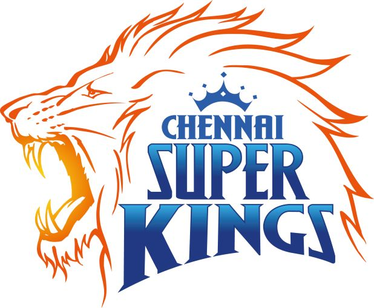
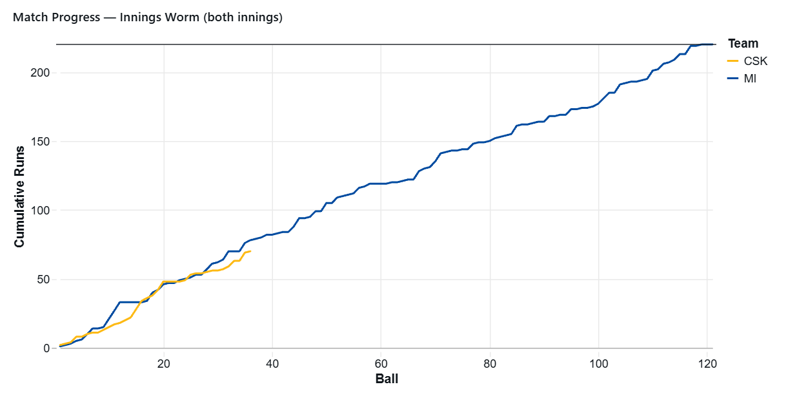
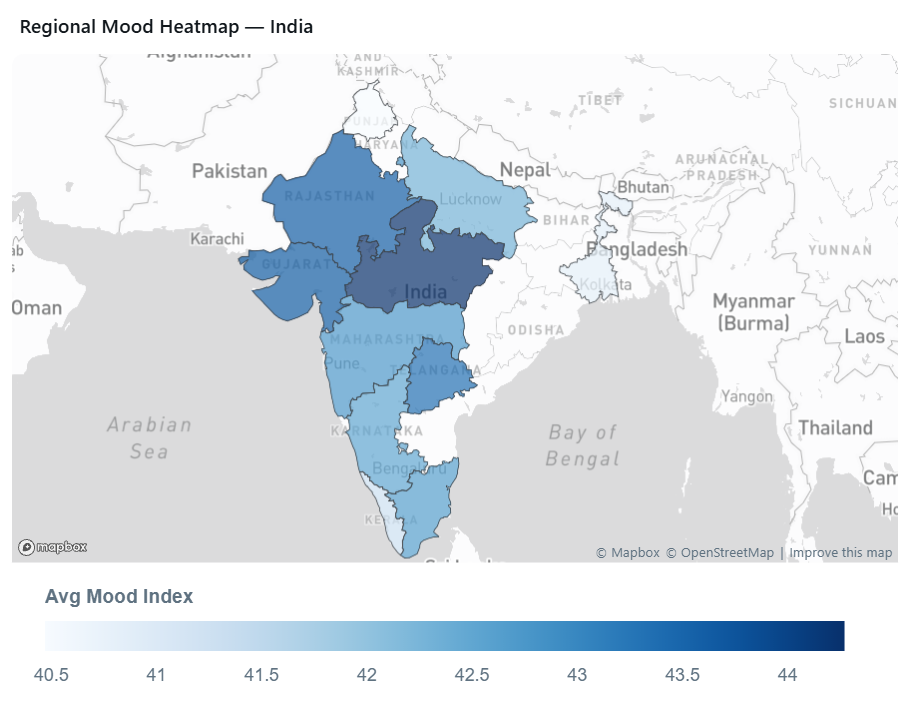
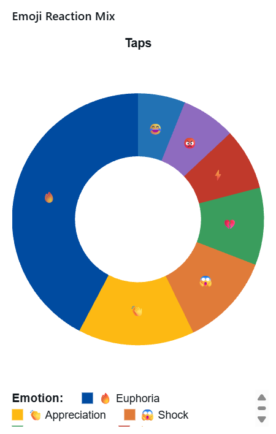
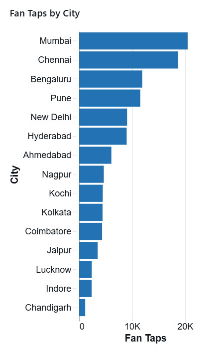

# 🏏 IPL Emoji Pulse 
### 🔥  🏏  🎉  👏  😱  😂  💔  😡
### Real-Time Fan Reaction & Match Sentiment Streaming Engine

*Capturing live stadium-scale fan emotions second-by-second and synchronizing them with real-time cricket match events.*

---

<h2>
  📊 Live Analytics & Dashboard
  
  
</h2>

<table>
  <tr>
    <td align="center" width="50%">
      <b>Match Progress — Innings Worm</b>  
      
    </td>
    <td align="center" width="50%">
      <b>Regional Mood Heatmap — India</b>  
      
    </td>
  </tr>
  <tr>
    <td align="center" width="50%">
      <b>Emoji Reaction Mix</b>  
      
    </td>
    <td align="center" width="50%">
      <b>Fan Taps by City</b>  
      
    </td>
  </tr>
</table>

---

## 🏆 Live Simulation Benchmark & Match Telemetry

During an end-to-end live streaming run simulation of the **IPL 2026 Final (MI vs. CSK at Wankhede Stadium, Mumbai)**, the platform processed high-velocity fan reactions alongside real-time ball-by-ball telemetry across **157 deliveries (~39+ minutes of continuous streaming)**:

<table>
  <tr>
    <td align="center" width="33%">
      <h3>120,450+</h3>
      <b>Fan Emoji Reactions Streamed</b> 
      Ingested at ~50 events/sec via Apache Kafka
    </td>
    <td align="center" width="33%">
      <h3>157</h3>
      <b>Ball-by-Ball Deliveries Processed</b> 
      Atomic JSON events at 15s intervals via Auto Loader
    </td>
    <td align="center" width="33%">
      <h3>14s Window</h3>
      <b>Salted Stream Attribution</b> 
      Zero partition skew across 8 salt buckets
    </td>
  </tr>
</table>

### 🏏 Simulated Match Snapshot (`MI vs. CSK`)
* **1st Innings (Mumbai Indians):** **220 / 10** — High-scoring powerplay and death-over surge driving peak crowd euphoria and boundary spikes.
* **2nd Innings (Chennai Super Kings):** **70 / 1** *(through 6.0 Powerplay overs)* — Aggressive chasing start triggering intense head-to-head fan sentiment polarization across Indian metros.

---

## 🌟 Overview

**IPL Emoji Pulse** is an end-to-end real-time streaming data engineering platform built to process high-velocity fan reactions alongside live ball-by-ball cricket match telemetry. 

During high volt T20 matches, thousands of fans react every second while deliveries unfold every few seconds. This platform ingests both asynchronous streams, eliminates partition skew at scale, enriches events with master reference data, and delivers real-time sentiment analytics—from rolling crowd pulse meters to team rivalry polarization and regional fan heatmaps.

---
## 🏗️ End-to-End Architecture & Data Flow

The platform follows a **real-time Medallion Architecture** orchestrated via **Databricks Lakeflow Declarative Pipelines (Continuous Mode)**, unifying asynchronous event streams and reference data into low-latency analytical views without revealing internal table schemas.

### 1️⃣ Ingestion Sources
* ⚡ **Fan Reaction Stream (`Apache Kafka` + `Python`):** Streams high-velocity live viewer emoji reactions (~50 events/sec) via Python engine.
* 🏏 **Match Telemetry Stream (`Stateful JSON Producer`):** Emits ball-by-ball match deliveries every 15 seconds via `.json` writes into Unity Catalog Volumes, featuring disk-based state recovery to resume mid-match without duplicates.
* 🗄️ **Master Reference Store (`PostgreSQL`):** Supplies static lookup dimensions (squad rosters, player popularity tiers, and emoji sentiment/arousal weights).

---

### 2️⃣ Lakehouse Medallion Processing

#### 🥉 Bronze Layer — *Multi-Source Streaming Ingestion*
* Unifies continuous **Kafka** event ingestion, incremental **Auto Loader** JSON file pickup, and **PostgreSQL** reference table ingestion into append-only Delta tables inside a single declarative DAG.

#### 🥈 Silver Layer — *Quality Guardrails, Skew Mitigation & Enrichment*
* **Declarative Quality & Deduplication:** Enforces pipeline expectations to filter out automated bot/spam bursts alongside watermark-bounded deduplication for idempotent processing.
* **Broadcast Dimensional Role-Playing:** Enriches high-throughput streams in memory against player and emoji reference dimensions using low-latency broadcast joins.
* **Salted Stream-Stream Interval Join:** Eliminates single-match hot-partition skew by hashing fan events across **8 deterministic salt buckets (`0..7`)** and attributing each reaction to its exact delivery within a watermarked 14-second interval window.

#### 🥇 Gold Layer — *Hybrid Streaming & Materialized Analytics*
* **Windowed Pulse & Regional Heatmaps:** Uses watermarked sliding and tumbling windows to serve live rolling crowd sentiment and Indian state/city fan activity.
* **Multi-Granularity Rollups & Rivalry Polarization:** Incrementally maintains multi-level ball/over momentum summaries and head-to-head team sentiment polarization without manual merge boilerplate.

---

## 🛠️ Tech Stack

| Technology | Layer & Role |
| :--- | :--- |
| **Apache Kafka** | **Event Streaming:** High-throughput message broker ingesting real-time fan emoji reaction streams (~50 events/sec). |
| **Databricks** | **Lakehouse & Stream Processing:** End-to-end Bronze → Silver → Gold orchestration powered by **Lakeflow Declarative Pipelines**, **Spark Structured Streaming**, **Auto Loader (`cloudFiles`)**, **Delta Lake** (ACID transactions), and **Unity Catalog** (governance, lineage & managed volumes). |
| **PostgreSQL** | **Master Reference Store:** Relational database hosting static player rosters, popularity tiers, and emoji sentiment/arousal dimensions. |
| **Python** | **Producers & Pipeline Logic:** Powers stateful fault-tolerant event generators, PySpark transformations, and declarative pipeline definitions. |

---

  Built with Python, Apache Kafka, Spark Structured Streaming, and Databricks Lakeflow Declarative Pipelines.

